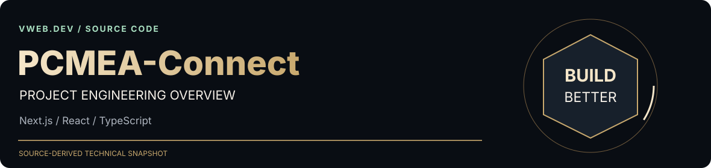

<!-- VWEB:AUTO-README:START -->

### Code-derived project snapshot

| Attribute | Detected value |
|---|---|
| Latest source revision | `33f27cf5acf0` |
| Tracked files reviewed | 123 |
| Framework and platform indicators | Next.js  /  React  /  TypeScript |
| Source file types | TypeScript (98), JSON (7), CSS (1) |
| Main directories | src, public, docs |

> This section is regenerated from tracked filenames and manifests on code updates. It is not a QA or production-readiness certification. Handwritten project documentation is preserved.
<!-- VWEB:AUTO-README:END -->

# Firebase Studio

This is a NextJS starter in Firebase Studio.

To get started, take a look at src/app/page.tsx.
